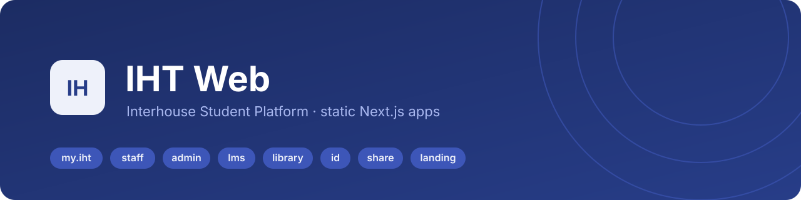
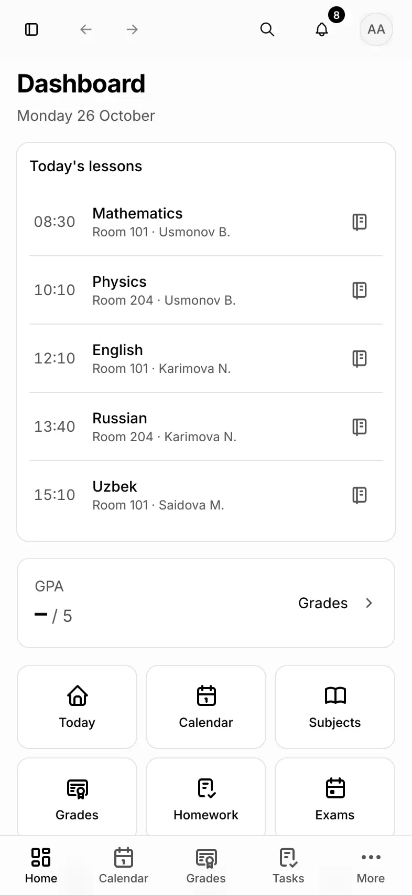
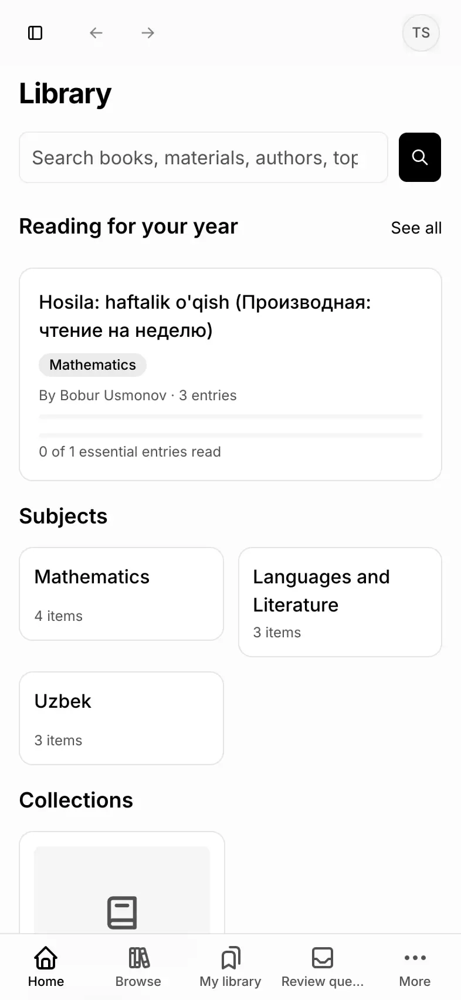
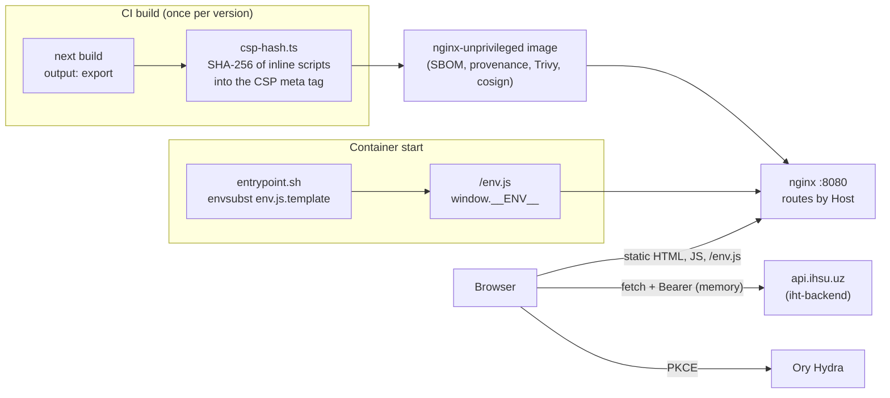

<p align="center">
  
</p>

<p align="center">
  <a href="https://github.com/interhousedev/ihsp-web/actions/workflows/test.yml"></a>
  <a href="https://github.com/interhousedev/ihsp-web/actions/workflows/codeql.yml"></a>
  <a href="https://github.com/interhousedev/ihsp-web/actions/workflows/build.yml"></a>
  <a href="LICENSE"></a>
  <a href="https://bun.sh"></a>
  <a href="https://nextjs.org"></a>
</p>

<p align="center">
  <a href="#apps">Apps</a> ·
  <a href="#architecture">Architecture</a> ·
  <a href="#security">Security</a> ·
  <a href="#quick-start">Quick start</a> ·
  <a href="#tests-and-checks">Testing</a> ·
  <a href="#deployment">Deploy</a> ·
  <a href="CONTRIBUTING.md">Contributing</a> ·
  <a href="SECURITY.md">Security policy</a>
</p>

# iht-web

Web apps of the IHT platform: the student and staff platform of the Academic Lyceum International House Tashkent (internal name IHSP, Interhouse Student Platform). It covers daily school life: calendar, marks, homework, attendance, an AI study assistant with notebooks, a library, courses (LMS), files and links, a student mailbox and a Telegram mini app.

The backend lives in the sibling repository `iht-backend`. This repository holds eight statically exported Next.js apps, the shared packages, the nginx image that serves them, and the end-to-end tests.

## Apps

| App | Directory | What it does | Screenshot |
|---|---|---|---|
| **id** (IHT ID) | `apps/id` | Sign-in, registration, one-time codes, Telegram login, account security; the OAuth front end for Ory Hydra. | _screenshot pending_ |
| **sp** (my.iht) | `apps/sp` | The student app: today, timetable, marks, homework, AI assistant, notebooks, mail, files. Also the PWA and the Telegram mini app. |   |
| **staff** (IHT Учителям) | `apps/staff` | Teachers and curators: journal, attendance, work-offs, classes. |  |
| **admin** | `apps/admin` | Administration: users, roles, broadcasts, knowledge base, AI limits and usage, jobs and logs. | _screenshot pending_ |
| **lms** | `apps/lms` | Courses: modules, lessons and steps, editor for course staff. |  |
| **share** | `apps/share` | Public read-only pages for shared chats and flash card sets. | _screenshot pending_ |
| **library** | `apps/library` | Catalogue, reader and librarian tools. |  |
| **landing** | `apps/landing` | Public landing page for applicants and students. | _screenshot pending_ |

More screens: [timetable](apps/landing/public/screens/sp-timetable.webp), [marks](apps/landing/public/screens/sp-marks.webp), [notebooks](apps/landing/public/screens/sp-notebooks.webp).

## Apps and hosts

| Product | Directory | Production host | Dev port | For |
|---|---|---|---|---|
| my.iht | `apps/sp` | `my.ihsu.uz`, installable app on `app.ihsu.uz` | 3002 | students |
| IHT Учителям | `apps/staff` | `staff.ihsu.uz` | 3003 | teachers, curators |
| admin.iht | `apps/admin` | `admin.ihsu.uz` | 3004 | administration |
| lms.iht | `apps/lms` | `lms.ihsu.uz` | 3005 | courses |
| library.iht | `apps/library` | `lib.ihsu.uz` | 3008 | library |
| IHT ID | `apps/id` | `id.ihsu.uz` | 3001 | sign-in, registration, security (single sign-on through Ory Hydra) |
| Shares | `apps/share` | `s.ihsu.uz/ai/` | 3006 | public shared chats and flash card sets |
| Landing | `apps/landing` | `ihsu.uz`, `www.ihsu.uz` | 3009 | public landing page (applicants, students) |

The API and MCP servers are `api.ihsu.uz` and `mcp.ihsu.uz`, served by iht-backend. The directory name `sp` is historic; the product is my.iht.

## Architecture



- Next.js 16 with `output: "export"`: every app is plain static files, with no Node server in production. React 19, TypeScript `strict`, Tailwind CSS 4, shadcn/ui (`base-nova`, Base UI), TanStack Query and Form, Zod 4, `nuqs`, Zustand, `next-intl` without locale routing (uz, ru, en).
- Bun workspaces: `apps/*` and `packages/*`.
- One build runs in every environment. Runtime configuration comes from `/env.js` (`window.__ENV__`), rendered at container start from environment variables; `@ihsp/config` reads it.
- The apps talk to the backend through a typed client generated from the backend's OpenAPI document (`openapi-typescript`, `openapi-fetch`). Sign-in is OAuth with PKCE against Ory Hydra; the access token lives only in memory.
- The image is `nginxinc/nginx-unprivileged` on port 8080 and routes by `Host` to the right app. Inline scripts are allowed by SHA-256 hashes written into a CSP meta tag after the build (`deploy/csp-hash.ts`).

## Security

- **Sign-in:** OAuth 2 authorization code flow with PKCE against Ory Hydra, through the `id` app. No client secret ships to the browser.
- **Tokens:** the access token (10 minutes) lives only in memory, never in `localStorage`; the refresh token is an `HttpOnly`, `Secure` cookie on the API host that scripts cannot read. A 401 at any time sends the user back through sign-in.
- **No server runtime:** the apps are static files served by unprivileged nginx. There are no route handlers, server actions or Node processes to attack.
- **Strict CSP:** no `unsafe-inline` scripts; every inline script is allowed by its SHA-256 hash, written after the build by `deploy/csp-hash.ts`. End-to-end tests fail on any CSP violation.
- **Rendering model output:** AI answers render through the OpenUI renderer, which only knows an allowlisted component catalogue (`packages/features-core/src/openui/catalog.json`), clamps strings and lists, and accepts only `https:` links. Markdown is rendered without raw HTML. `dangerouslySetInnerHTML` is limited to the hashed theme script in the layouts, chart CSS variables and the admin Telegram preview, whose serializer escapes all text.
- **Supply chain:** pinned actions, Dependabot, CodeQL, a secrets scan, and for every image an SBOM, provenance attestation, a Trivy scan that fails on fixable critical and high findings, and a keyless cosign signature.

Report vulnerabilities privately; see [SECURITY.md](SECURITY.md).

## Quick start

```bash
git clone https://github.com/interhousedev/ihsp-web.git iht-web
cd iht-web
bun install
cd apps/sp && bun run dev    # http://localhost:3002, needs the backend on :8000
```

The details, including the backend and the Docker stack, are in [Local development](#local-development).

## Repository layout

| Path | Content |
|---|---|
| `apps/` | `id`, `sp`, `staff`, `admin`, `lms`, `library`, `share`, `landing` |
| `packages/ui` | shadcn/ui primitives, layout, data tables, theme |
| `packages/api` | generated API types, fetch client, query keys, endpoint types, the vendored `openapi.json`, contract check scripts |
| `packages/auth` | OIDC with PKCE, token store, role guards, mini-app login |
| `packages/config` | `window.__ENV__` loader and validation |
| `packages/features-core` | features shared by several apps: assistant, notebooks, library, flash cards, mail, notifications, PWA, shell |
| `packages/i18n` | shared messages and the `useT` hook |
| `packages/telegram` | Telegram mini app support |
| `packages/test-utils` | test preload, fixtures, MSW handlers typed by the OpenAPI types |
| `packages/tsconfig` | shared TypeScript configs |
| `deploy/` | nginx image: `Dockerfile`, `Dockerfile.prebuilt`, `entrypoint.sh`, `env.js.template`, `csp-hash.ts`, `sites/`, `snippets/`, tests |
| `e2e/` | Playwright specs |

## Prerequisites

- [Bun](https://bun.sh) 1.3.
- Node 22 types (`@types/node`); Node itself is not needed to run the repository.
- For the full local stack and the end-to-end tests: Docker 28 or newer and a checkout of `iht-backend` next to this repository (`../iht-backend`).

## Local development

```bash
bun install                  # CI and Docker: bun install --frozen-lockfile
bun run dev                  # every app: id 3001, sp 3002, staff 3003, admin 3004, lms 3005, share 3006, library 3008, landing 3009
cd apps/sp && bun run dev    # a single app
```

The apps call the API on `http://localhost:8000` and Hydra on `http://localhost:4444` directly. Start the backend from the `iht-backend` checkout: `scripts/dev.sh all` (plus `worker`, `scheduler` and `bot` in other terminals), then once `uv run python scripts/hydra_bootstrap.py` and `uv run python -m app seed-demo`. Login codes arrive in Mailpit at `http://localhost:8025`.

To run the whole product in Docker instead, use `scripts/local_up.sh` in iht-backend. It builds the apps of this repository on the host, one at a time, and packs them with `deploy/Dockerfile.prebuilt`. It finds this repository at `../iht-web` or at `IHSP_WEB_DIR`. Then open `http://my.localhost/`.

Demo logins (local stack only): `abdullayev.alisher` / `StudentDemo1`, `usmonov.bobur` / `TeacherDemo1`, `admin.ihsp` / `AdminDemo1` (needs a one-time code from Mailpit), `tursunov.sardor` / `LibrarianDemo1`.

Runtime configuration: in development each app serves its own `public/env.js` with dev values; in the container `deploy/entrypoint.sh` renders `deploy/env.js.template` with `envsubst` from variables such as `IHSP_WEB_API_URL`, `IHSP_WEB_ID_URL`, `IHSP_WEB_HYDRA_URL`, `APP_ENV` and `PWA_APPS`. Never read configuration at module scope; call `getConfig()`.

## Fake and real modes

The web repository has no secrets. Whether the backend uses real EMIS, OpenRouter, Exa or Telegram is decided by the backend's git-ignored `.env.local` (see the iht-backend README). The web apps behave the same in both modes.

## Tests and checks

```bash
bun run check                           # oxlint, oxfmt --check, typecheck of every workspace, e2e typecheck
bun run lint                            # oxlint .
bunx oxfmt --check .                    # formatting (oxfmt, not prettier); bun run format writes it
bun run --filter '*' typecheck          # tsc --noEmit in every workspace
cd apps/sp && bun run test              # one app or package
bun test deploy                         # nginx and entrypoint tests
bun run e2e                             # Playwright against a running backend
```

Always use `bun run test` inside an app or package; a bare `bun test` there fails with "/env.js was not loaded" because the package script passes the preload that sets up `window.__ENV__`, happy-dom and MSW. From the repository root, `bun test apps packages` also works. Playwright needs the backend running with demo data (`E2E_STACK=local` tests the Docker stack instead of the dev servers).

## API contract workflow

The backend exports `openapi/openapi.json`. This repository keeps a copy at `packages/api/openapi.json`; the typed client and the contract check are generated from it.

```bash
bun run sync:openapi        # copies ../iht-backend/openapi/openapi.json (or $IHSP_BACKEND_DIR), then gen:api and gen:contract
bun run contract:check      # the hand-written endpoint types must type-check against the generated types
```

Commit `packages/api/openapi.json` and the generated files together. CI regenerates them from the vendored document and fails when the committed files differ.

## Deployment

CI builds and publishes the image `ghcr.io/<owner>/ihsp-web`. The apps are built on the runner one at a time (a parallel `next build` of all apps needs too much memory), the CSP hashes are written, and `deploy/Dockerfile.prebuilt` packs the exports into the nginx image. The server (see the iht-backend README) pulls the image; the edge nginx terminates TLS and proxies the static hosts to the `web` container, which serves them by `Host` header. Environment variables of the container are listed at the top of `deploy/entrypoint.sh`. `deploy/Dockerfile` builds everything inside Docker and is meant for machines with plenty of memory.

## Continuous integration

| Workflow | When | What |
|---|---|---|
| `lint.yml` | every push and pull request | `oxlint`, `oxfmt --check`, typecheck of every workspace and of `e2e` |
| `test.yml` | pull requests to `main` | `bun run test` in every workspace, `bun test deploy`, regeneration of the API client from `packages/api/openapi.json` with `git diff --exit-code`, `contract:check`, a secrets scan |
| `build.yml` | pushes to `main`, tags `v*`, manual | builds the apps, builds and pushes `ghcr.io/<owner>/ihsp-web`, SBOM and provenance, Trivy scan (fails on fixable critical and high findings), keyless cosign signature, channel tags |
| `codeql.yml` | pull requests, `main`, weekly | CodeQL for JavaScript and TypeScript |

Dependabot updates the actions, the base images and the Bun dependencies weekly. A tag `v1.2.3` publishes the image as `1.2.3` and bakes that version into the apps (`NEXT_PUBLIC_APP_VERSION`), which the installable app compares with the backend's `GET /v1/app/version`.

Error tracking (Bugsink, Sentry protocol) is set at build time with `NEXT_PUBLIC_BUGSINK_DSN` (a public DSN, empty by default). When it is empty no client is started; when it is set, the browser sends errors with no user data, cookies, headers, IP addresses, input breadcrumbs or replays. The page CSP (`connect-src`, `CSP_CONNECT_SRC`) must allow the DSN host; the default `'self' https:` already does.

## Contributing

Contributions are welcome. Read [CONTRIBUTING.md](CONTRIBUTING.md) and [CODESTYLE.md](CODESTYLE.md) first; everyone taking part follows the [Code of Conduct](CODE_OF_CONDUCT.md). [CLAUDE.md](CLAUDE.md) and `.claude/skills/` hold the instructions for Claude Code and other agents.

## Licence

Copyright (C) 2026 Alex Sayfi and contributors.

Licensed under the [GNU Affero General Public License v3.0 only](LICENSE) (`AGPL-3.0-only`). If you run a modified version as a network service, you must offer its users the corresponding source code.
