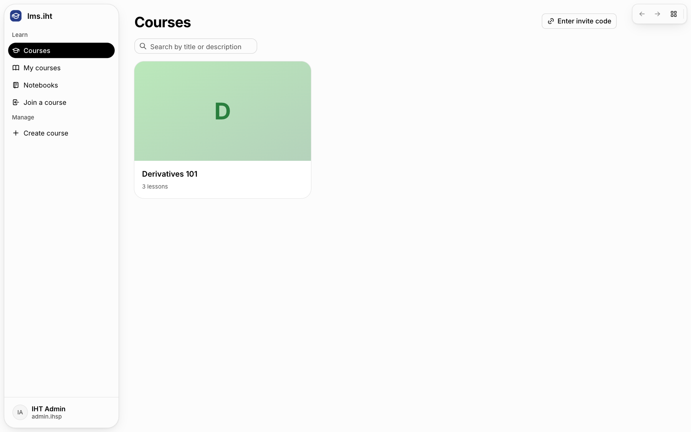

<p align="center">
  
</p>

# IHT LMS

Courses: modules, lessons and steps, with an editor for course staff.

## Overview

- Package `@ihsp/lms`, a statically exported Next.js 16 app in the `iht-web` workspace.
- Production host: `lms.ihsu.uz`. Dev port: 3005.
- Shared code lives in `packages/*` (`@ihsp/ui`, `@ihsp/api`, `@ihsp/auth`, `@ihsp/i18n`); UI text is in `messages/<locale>` for uz, ru and en.

## Run

```bash
bun install --frozen-lockfile        # once, at the repository root
cd apps/lms && bun run dev           # http://localhost:3005, needs the backend on :8000
cd apps/lms && bun run test          # tests of this app
bun run --filter ./apps/lms build    # static export to apps/lms/out
```

## Configuration

Runtime configuration comes only from `/env.js` (`window.__ENV__`): `public/env.js` in development, rendered by `deploy/entrypoint.sh` in the container. Read it through `getConfig()` from `@ihsp/config`, never at module scope.

## Screens

Screenshots live in `docs/assets/screens/` at the repository root.



## Links

- [Repository README](../../README.md) and [CODESTYLE.md](../../CODESTYLE.md)
- Backend: the sibling repository `iht-backend`; the contract is `packages/api/openapi.json`
